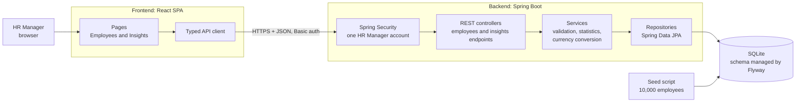
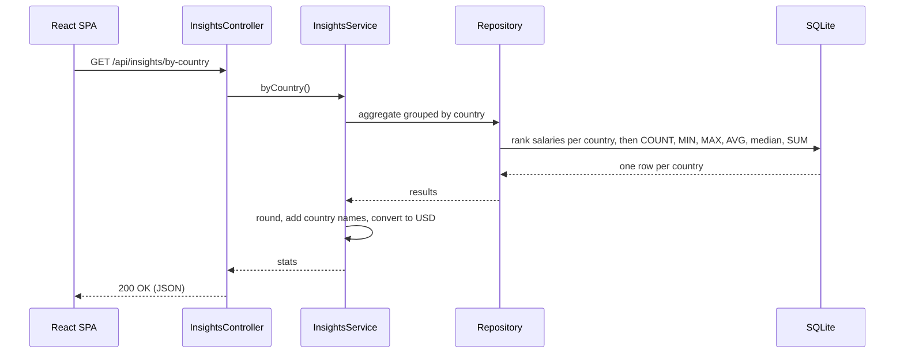
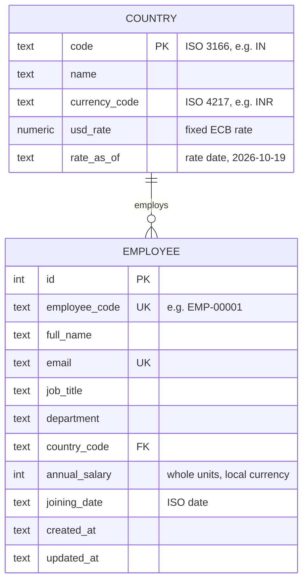
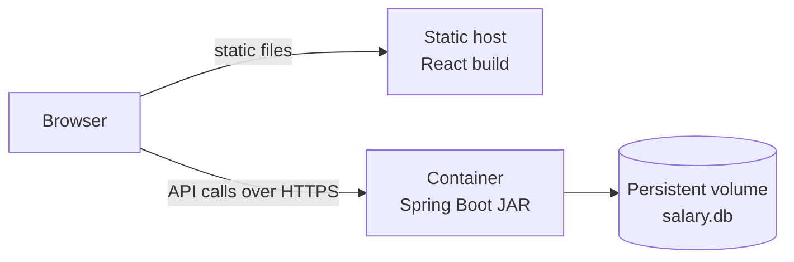
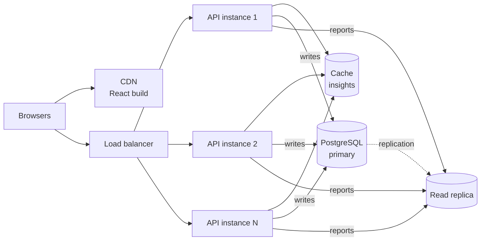

# Architecture

> Diagrams use Mermaid, which GitHub renders automatically.

## 1. System overview

The HR Manager signs in to a React single-page app in the browser. It calls a Spring Boot REST API, which stores data in SQLite.



| Part | Responsibility |
|---|---|
| **React SPA** | Screens, forms, client-side validation feedback. No business rules. |
| **Spring Security** | Rejects any `/api` call without the HR Manager's credentials (401). Stateless: no session or cookie. |
| **Controllers** | HTTP only: parse requests, return status codes and JSON. |
| **Services** | Business rules: validation, salary statistics, currency conversion. Unit-tested without a database. |
| **Repositories** | Database access. Filtering, sorting, paging and aggregation run in SQL. |
| **SQLite + Flyway** | Storage. Versioned migrations create and change the schema. |

## 2. Backend structure

Code is grouped by feature, not by technical layer, so each feature can be read and changed in one place.

```
com.acme.salary
├── auth/         Security configuration, current-user endpoint
├── employee/     Employee entity, search query, service, controller, job catalog
├── insights/     Salary statistics SQL, service and endpoints
├── country/      Countries, fixed USD rates, currency conversion, reference data endpoint
├── seed/         Deterministic generator and loader for 10,000 employees
└── common/       Error handling, paging, date converters
```

## 3. Request flow: "Average salary by country"



Aggregation runs in the database, so only a few rows per country are sent back to the application, not all 10,000 employees.

## 4. Data model



Defined in `backend/src/main/resources/db/migration/`.

- Salaries are stored in the **local currency**, the way HR records them, and converted to USD only for cross-country comparisons.
- Salaries are **whole numbers** (`INTEGER`). SQLite has no exact decimal type, and annual salaries are whole amounts, so an integer is exact.
- The **currency belongs to the country**, so an employee cannot be paid in a currency that doesn't match their country.
- **Dates are ISO-8601 text** (`2022-04-01`). SQLite has no date type, and ISO text is unambiguous and sorts correctly.
- The database itself enforces positive salaries, unique codes and emails, and valid countries (foreign keys are switched on in the connection settings).
- Indexes on `(country_code, job_title)` and `job_title` support filtering and insights.
- Exchange rates are the ECB reference rates of 19 October 2026, stored with their date (migration `V3`); see `docs/requirements.md`.
- Only the current salary is kept. If salary history is required, a `SALARY_REVISION` table (employee, amount, effective date) would be added.

## 5. Deployment



The frontend is a static build that can be served from any static host or CDN. The backend runs as a single container, with the SQLite file on a persistent volume.

| Setting | Where | Purpose |
|---|---|---|
| `PORT` | backend | Port to listen on (default 8081) |
| `DB_URL` | backend | SQLite file location |
| `APP_USERNAME`, `APP_PASSWORD` | backend | The HR Manager account; without a password a random one is logged at startup |
| `CORS_ALLOWED_ORIGINS` | backend | The frontend's address, when it is on another domain |
| `VITE_API_URL` | frontend build | The API's address, when it is on another domain |

## 6. Scalability

### Current target: 10,000 employees, one HR user

The current design handles this comfortably:

- **Pagination:** the API returns one page (e.g. 50 rows) at a time, never all 10,000.
- **Database-side filtering and aggregation:** the database does the work, and only results cross the network.
- **Indexes** on the filtered and searched columns keep queries fast as data grows.
- **Small data:** 10,000 employees take 2.7 MB in SQLite.

**Measured** on a laptop, with 10,000 seeded employees and requests made through the HTTP API:

| Operation | Time |
|---|---|
| Seed 10,000 employees | 1.3 s |
| Any insights endpoint (overview, by country, by job title) | 0.07–0.14 s |
| Employee list page: default, sorted by salary, search + filter, last page | about 0.1 s |

### Limits of this design

| Limit | Why |
|---|---|
| One writer at a time | SQLite locks the whole database for each write. Fine for one HR user, not for many concurrent editors. |
| One backend instance | The SQLite file lives on a single machine, so the backend can't be run as several instances. |
| Statistics computed on every request | Fine at 10,000 rows; slower at millions.|

### How it would scale

The layered design means each step below changes one part without rewriting the others.

| Stage | Scale | Change |
|---|---|---|
| **1. Now** | 10k employees, 1 HR user | SQLite, single instance |
| **2. Growth** | 100k–1M employees, a whole HR team | Move to **PostgreSQL** (a driver and config change, since JPA and Flyway hide the database), add **caching** for insights |
| **3. Large** | Millions of employees, many concurrent users | **Several stateless backend instances** behind a load balancer, **read replicas** for reporting, **precomputed summary tables** refreshed when salaries change |

The backend keeps no user state in memory between requests, so stage 3 only needs more instances; no code changes are required to support that.



At that scale, the single account would be replaced by the company's identity provider (OpenID Connect) with **role-based access** and an audit log, because several HR users would see and change sensitive salary data. The API is already stateless, so token-based sign-in fits without changing the scaling model.
