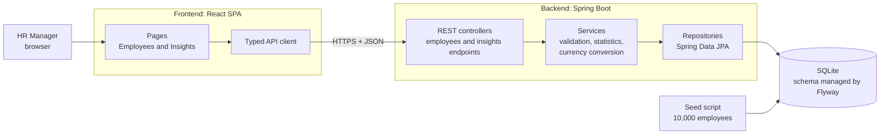
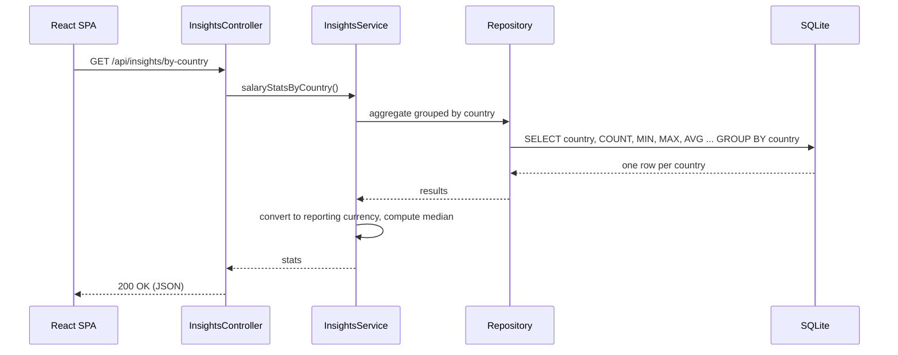
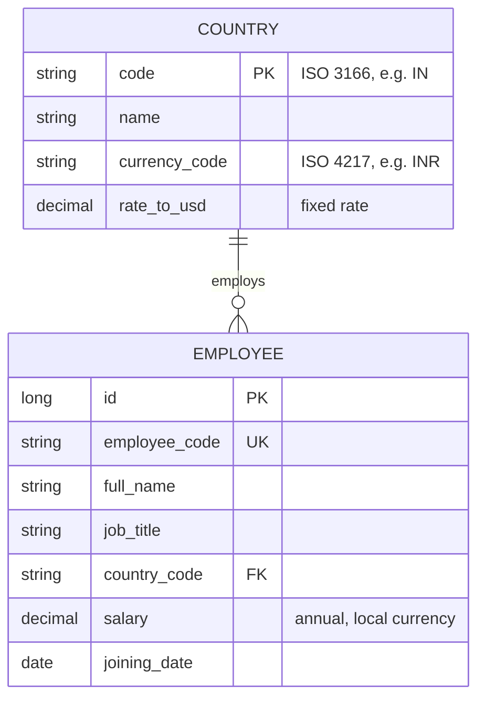
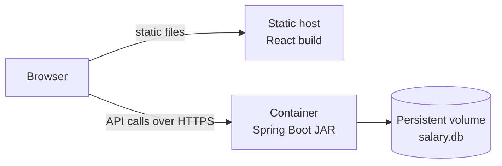
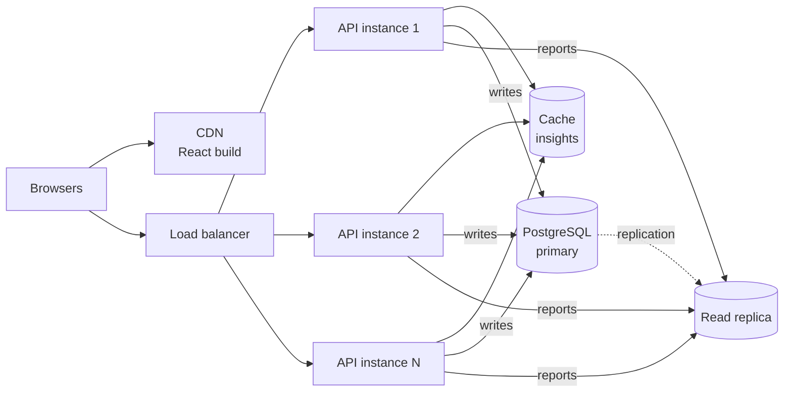

# Architecture

> Diagrams use Mermaid, which GitHub renders automatically. The data model is provisional until the clarifying questions are answered.

## 1. System overview

The HR Manager uses a React single-page app in the browser. It calls a Spring Boot REST API, which stores data in SQLite.



| Part | Responsibility |
|---|---|
| **React SPA** | Screens, forms, client-side validation feedback. No business rules. |
| **Controllers** | HTTP only: parse requests, return status codes and JSON. |
| **Services** | Business rules: validation, salary statistics, currency conversion. Unit-tested without a database. |
| **Repositories** | Database access. Filtering, sorting, paging and aggregation run in SQL. |
| **SQLite + Flyway** | Storage. Versioned migrations create and change the schema. |

## 2. Backend structure

Code is grouped by feature, not by technical layer, so each feature can be read and changed in one place.

```
com.acme.salary
├── employee/     Employee entity, repository, service, controller, DTOs
├── insights/     Salary statistics queries and endpoints
├── currency/     Fixed exchange rates and conversion
└── common/       Error handling, shared validation
```

## 3. Request flow: "Average salary by country"



Aggregation runs in the database, so only a few rows per country are sent back to the application, not all 10,000 employees.

## 4. Data model (provisional)



- Salaries are stored in the **local currency**, the way HR records them, and converted only for cross-country comparisons.
- Money uses `decimal` (`BigDecimal` in Java), never floating point, to avoid rounding errors.
- Indexes on `country_code`, `job_title` and `full_name` support the filters and search.
- If salary history is required, a `SALARY_REVISION` table (employee, amount, effective date) would be added.

## 5. Deployment



The frontend is a static build that can be served from any static host or CDN. The backend runs as a single container, with the SQLite file on a persistent volume.

## 6. Scalability

### Current target: 10,000 employees, one HR user

The current design handles this comfortably:

- **Pagination:** the API returns one page (e.g. 50 rows) at a time, never all 10,000.
- **Database-side filtering and aggregation:** the database does the work, and only results cross the network.
- **Indexes** on the filtered and searched columns keep queries fast as data grows.
- **Small data:** 10,000 rows is a few MB in SQLite, and aggregate queries over it are expected to take milliseconds.

### Limits of this design

| Limit | Why |
|---|---|
| One writer at a time | SQLite locks the whole database for each write. Fine for one HR user, not for many concurrent editors. |
| One backend instance | The SQLite file lives on a single machine, so the backend can't be run as several instances. |
| Statistics computed on every request | Fine at 10,000 rows; slower at millions. |

### How it would scale

The layered design means each step below changes one part without rewriting the others.

| Stage | Scale | Change |
|---|---|---|
| **1. Now** | 10k employees, 1 HR user | SQLite, single instance |
| **2. Growth** | 100k–1M employees, a whole HR team | Move to **PostgreSQL** (a driver and config change, since JPA and Flyway hide the database), add **caching** for insights |
| **3. Large** | Millions of employees, many concurrent users | **Several stateless backend instances** behind a load balancer, **read replicas** for reporting, **precomputed summary tables** refreshed when salaries change |

The backend keeps no user state in memory between requests, so stage 3 only needs more instances; no code changes are required to support that.



At that scale, **authentication and role-based access** would also be needed, because several HR users would see and change sensitive salary data.
